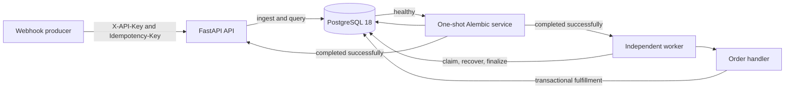

# EventLedger

EventLedger is a PostgreSQL-backed webhook ingestion and event-processing service built with FastAPI. It accepts source-authenticated events, detects source-scoped duplicates, processes work in an independent worker, records status and attempt history, and recovers work whose processing lease expires.

The repository demonstrates reliability patterns for a database-backed worker. It does not claim exactly-once execution, guaranteed eventual success, or production cloud deployment.

## Problem

Webhook receivers need to acknowledge durable ingestion quickly while handling duplicate requests, transient failures, worker crashes, and concurrent consumers. Performing the business operation in the HTTP request makes those concerns difficult to isolate. EventLedger instead persists an event first and lets independent workers claim and process it under PostgreSQL transactions.

## Implemented capabilities

- API-key authentication mapped to a server-configured source identity.
- Durable event ingestion with source-scoped idempotency keys.
- Source-isolated event detail, listing, filtering, status history, and attempt history.
- Atomic worker claims using row locks and `FOR UPDATE SKIP LOCKED`.
- Processing leases, expired-lease recovery, and lease-token fencing.
- Bounded exponential retry scheduling and permanent-failure handling.
- Transactional, source-scoped order-fulfillment uniqueness.
- One auditable manual retry grant for eligible terminal failures.
- PostgreSQL migrations, isolated integration tests, and Docker delivery services for the database, migration job, API, and worker.
- Separate process liveness and database/schema readiness endpoints.

Future operational work includes TLS termination, rate limiting, key rotation, a production secret manager, backups, monitoring and alerting, lease heartbeats, and cloud orchestration. See [Reliability and security](docs/RELIABILITY_AND_SECURITY.md) for the complete boundary.

## Technology

- Python 3.12 in the delivery image; package metadata supports Python 3.11 or newer
- FastAPI and Pydantic
- SQLAlchemy 2 and psycopg 3
- PostgreSQL 18
- Alembic
- pytest
- Docker Compose

## Architecture



The API and worker share no in-memory queue. PostgreSQL is the durable queue, coordination point, audit store, and local business-state store. More detailed component, sequence, and data-model diagrams are in [Architecture](docs/ARCHITECTURE.md).

## Event lifecycle

1. The API authenticates `X-API-Key` and derives `source_id` from server configuration.
2. `POST /v1/events` atomically inserts a `pending` event under the unique `(source_id, idempotency_key)` constraint.
3. A worker transaction locks one eligible row, increments its monotonic attempt number, creates an attempt row, assigns a lease token, and changes the event to `processing`.
4. The handler runs outside that claim transaction.
5. A separate fenced transaction records completion, a retryable failure, or a permanent failure.
6. An expired lease is finalized as `lease_expired`; the event is either scheduled again or terminally failed at its effective attempt limit.
7. An eligible failed event may receive one manual grant for exactly one additional attempt.

Event status is one of `pending`, `processing`, `completed`, or `failed`. Attempt outcome is one of `completed`, `retryable_failure`, `permanent_failure`, or `lease_expired`.

## API reference

All `/v1` endpoints require `X-API-Key`. Missing and invalid keys return `401`. Event resources are always scoped to the authenticated source; a missing event and an event owned by another source both return `404`.

| Method and path | Purpose | Important inputs | Success response |
|---|---|---|---|
| `GET /health` | Process liveness | None | `200 {"status":"ok"}` |
| `GET /ready` | Database connectivity and supported schema contract | None | `200 {"status":"ready"}` or safe `503` |
| `GET /v1/auth/check` | Verify API key and mapped source | `X-API-Key` | `200` with `source_id` |
| `POST /v1/events` | Ingest an event | `X-API-Key`, `Idempotency-Key`, JSON body | `201`; identical replay `200` |
| `GET /v1/events` | List source-owned events | Optional `status`, `event_type`, `created_from`, `created_to`, `limit`, `offset` | Paginated `200` |
| `GET /v1/events/{event_id}` | Get event detail and payload | UUID path | `200` or `404` |
| `GET /v1/events/{event_id}/history` | Get status transitions, oldest first | `limit` 1-100, `offset` at least 0 | Paginated `200` |
| `GET /v1/events/{event_id}/attempts` | Get safe attempt history, newest attempt first | `limit` 1-100, `offset` at least 0 | Paginated `200` |
| `POST /v1/events/{event_id}/retry` | Authorize one eligible manual retry | `X-API-Key`, retry-resource `Idempotency-Key` | `202`; identical replay `200` |

Event-list ordering is deterministic: `created_at DESC, id DESC`. `created_from` is inclusive, `created_to` is exclusive, both must be timezone-aware, and a supplied range must have `created_from < created_to`. Invalid query data returns `422`.

### Ingest an event

```powershell
$headers = @{
    "X-API-Key" = $apiKey
    "Idempotency-Key" = ([guid]::NewGuid().ToString("N"))
}
$body = @{
    event_type = "order.created"
    payload = @{ order_id = "ORDER-1001" }
} | ConvertTo-Json -Depth 5

$event = Invoke-RestMethod `
    -Method Post `
    -Uri "http://127.0.0.1:8001/v1/events" `
    -Headers $headers `
    -ContentType "application/json" `
    -Body $body
```

`event_type` is 1-100 characters in lowercase dotted form such as `order.created`. The request body cannot supply `source_id`; authentication determines it.

## Idempotency

Ingestion keys are 1-255 non-whitespace characters and are unique per authenticated source. Reusing a key with the same canonical `event_type` and payload returns the stored event with `200` and `X-Idempotent-Replay: true`. Reusing it for different content returns `409 idempotency_key_conflict`.

Manual-retry keys use the same length limit and are scoped to the individual event retry resource. The first eligible request returns `202`. Replaying its key returns the original stored acceptance with `200` and `X-Idempotent-Replay: true`, even if processing has since changed the event. A different key cannot create a second grant and returns `409 manual_retry_limit_reached`.

## Claims, leases, and retries

Workers select eligible events in `next_attempt_at` order and use row-level `FOR UPDATE SKIP LOCKED` locks so concurrent workers do not wait on the same claim. Claiming commits the attempt number, attempt row, lease token, expiry, and `processing` history before handler execution begins.

Finalization locks both the event and active attempt and checks the lease token, state, and expiry. A stale worker cannot finalize after ownership is lost. There is currently no lease heartbeat, so handler execution must finish within the configured lease duration.

Retryable failures use bounded exponential scheduling up to `WORKER_MAX_ATTEMPTS`. Permanent failures stop immediately. When the effective limit is reached, the event becomes `failed`. An eligible failed event whose latest attempt was `retryable_failure` or `lease_expired` may receive one manual grant. The grant stores an exact per-event attempt limit of `attempt_count + 1`; it never resets attempt numbering or deletes history.

## Local development

Requirements: Python 3.11 or newer, PostgreSQL 18, and Docker Desktop if using the supplied database service.

```powershell
py -3.12 -m venv .venv
.\.venv\Scripts\Activate.ps1
python -m pip install --upgrade pip
python -m pip install -e ".[dev]"
Copy-Item .env.example .env
```

Replace all placeholders in `.env`, then start only the development database and apply migrations:

```powershell
docker compose --env-file .env up -d db
python -m alembic upgrade head
```

Run API and worker in separate terminals:

```powershell
python -m uvicorn app.main:app --reload
python -m app.worker --log-level INFO
```

The development API defaults to `http://127.0.0.1:8000`. Do not point development commands at the isolated integration-test database.

## Docker delivery quickstart

The delivery stack publishes only the API at `127.0.0.1:8001`; PostgreSQL remains internal to the Compose network.

```powershell
Copy-Item .env.delivery.example .env.delivery
# Replace every CHANGE_ME value without committing the file.
$compose = @(
    "--project-name", "eventledger-d3demo",
    "--env-file", ".env.delivery",
    "-f", "compose.delivery.yaml"
)
docker compose @compose config --quiet
docker compose @compose build
docker compose @compose up -d
docker compose @compose ps -a
```

Compose waits for PostgreSQL health, runs the one-shot migration service, and starts the API and worker only after migration succeeds. The regular worker is forced to use `WORKER_FAILURE_SIMULATION_ENABLED=false`.

Stop without deleting persistent data:

```powershell
docker compose @compose stop
```

Do not use `down -v` for a delivery project whose data must be retained. The implemented guarantees, operational safeguards, and limitations are documented in [Reliability and security](docs/RELIABILITY_AND_SECURITY.md).

## Migrations

The current Alembic head is `d4e5f6a7b8c9`.

```powershell
# Local environment
python -m alembic current
python -m alembic upgrade head

# Delivery project, explicit one-shot job
docker compose @compose run --rm migrate
```

Do not run downgrades against a database containing data that must be preserved.

## Health and readiness

- `GET /health` proves the API process can serve a request. It does not access PostgreSQL.
- `GET /ready` executes a database query and checks the ShipSafe schema-compatibility bridge. Before the contract table exists, only legacy revision `d4e5f6a7b8c9` is accepted. After a later reviewed migration creates the table, the explicit contract version is authoritative. Failures return only `{"status":"not_ready"}` and do not expose database errors or credentials.
- Set `SHIPSAFE_PRODUCTION_MODE=true` for a ShipSafe runtime. Startup then requires a nonempty API key and a valid configured source identity; development remains opt-in and backward compatible.

## Tests

Regular tests use mocks or test-local overrides and do not opt into the real PostgreSQL suite:

```powershell
.\.venv\Scripts\python.exe -m pytest -m "not pg_integration"
```

PostgreSQL integration tests are guarded to accept only the dedicated local `eventledger_test` database, user, and port `5433`:

```powershell
Copy-Item .env.test.example .env.test
# Replace the test password placeholder in .env.test.
docker compose --env-file .env.test -f compose.test.yaml up -d db-test
.\.venv\Scripts\python.exe -m scripts.prepare_test_db
$env:EVENTLEDGER_RUN_PG_INTEGRATION = "1"
.\.venv\Scripts\python.exe -m pytest -m pg_integration
Remove-Item Env:EVENTLEDGER_RUN_PG_INTEGRATION
```

As of 2026-11-04, the complete combined Python 3.12 run reported **271 passing tests**, including tests against the guarded local PostgreSQL integration database. On the same date, the isolated `eventledger-d3demo` Docker acceptance run passed authentication, ingestion and retry idempotency, filtering, automatic and manual retries, lease-expiry recovery, fulfillment uniqueness, persistence, readiness, and fresh-volume startup. These are recorded observations, not performance benchmarks or cloud-deployment evidence.

## Security and delivery guarantees

EventLedger provides durable local ingestion, atomic database claims, bounded retries, expired-lease recovery, stale-worker fencing, and PostgreSQL-enforced local fulfillment uniqueness. Handler code can execute more than once, and an external side effect cannot be made exactly-once by this database transaction alone. Exhausting bounded attempts can leave an event failed; eventual success is not guaranteed.

The current authentication model is one static configured API key mapped to one source. It has no operator role, key rotation, TLS termination, or edge controls. Idempotency keys are stored in plaintext. Review [Reliability and security](docs/RELIABILITY_AND_SECURITY.md) before evaluating deployment suitability.

## Documentation

- [Architecture](docs/ARCHITECTURE.md)
- [Reliability and security](docs/RELIABILITY_AND_SECURITY.md)
- [Project summary](docs/PROJECT_SUMMARY.md)
- [ShipSafe compatibility bridge](shipsafe/docs/COMPATIBILITY.md)
