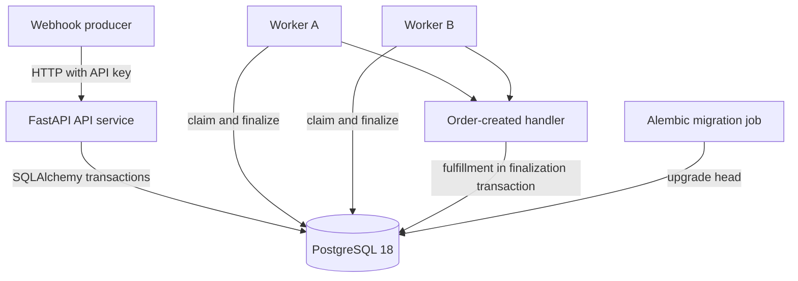
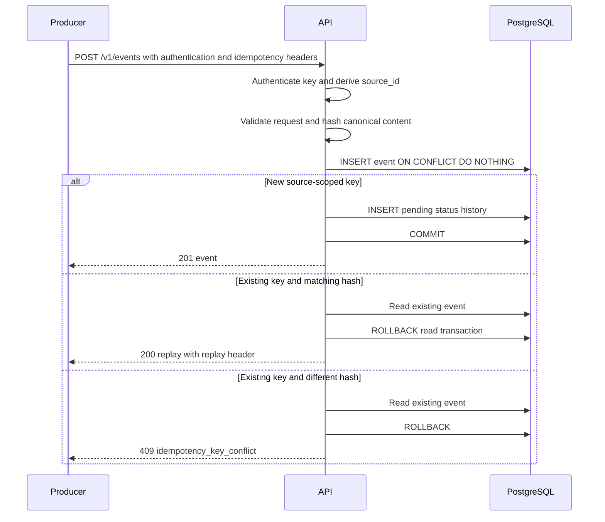
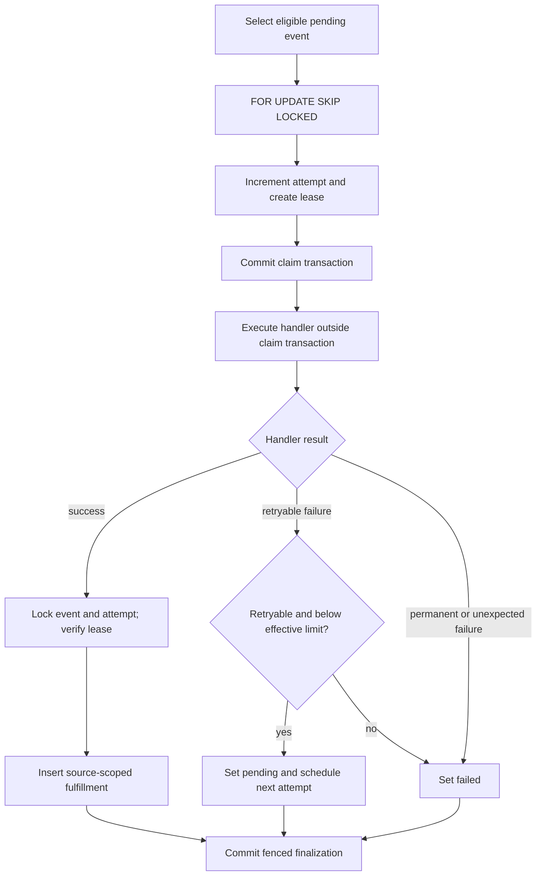
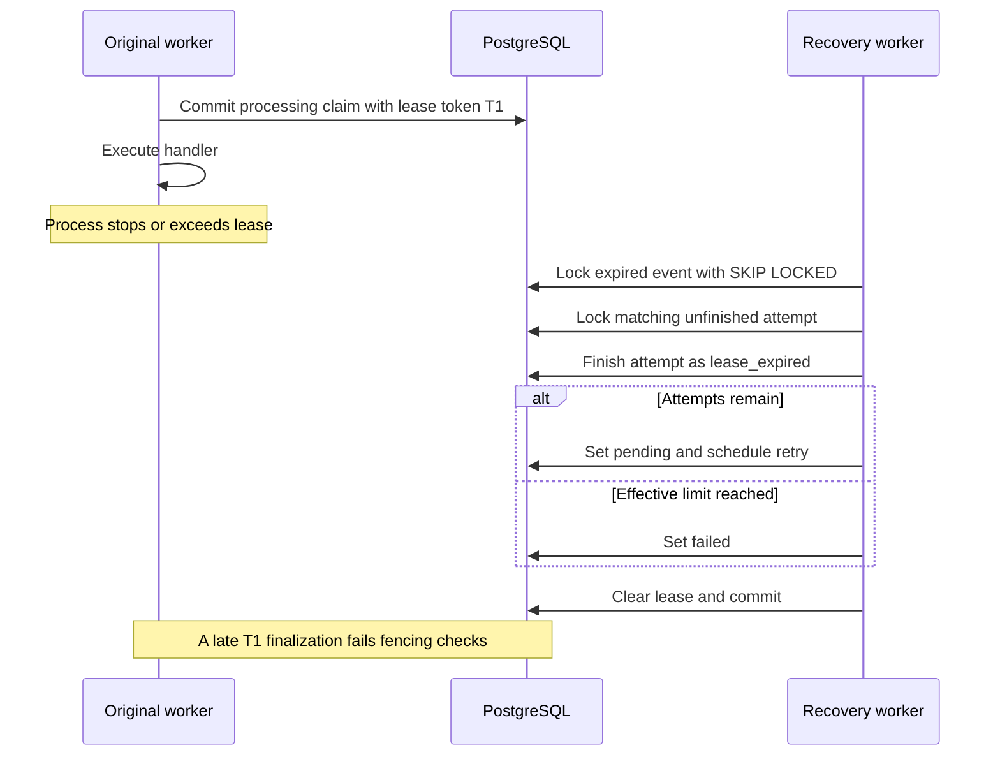
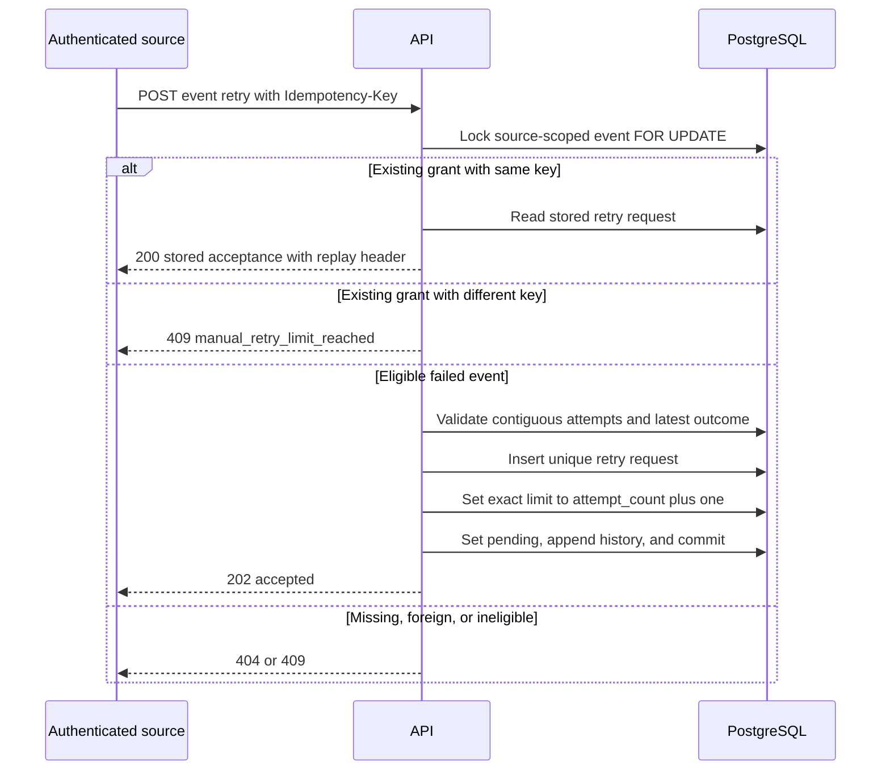
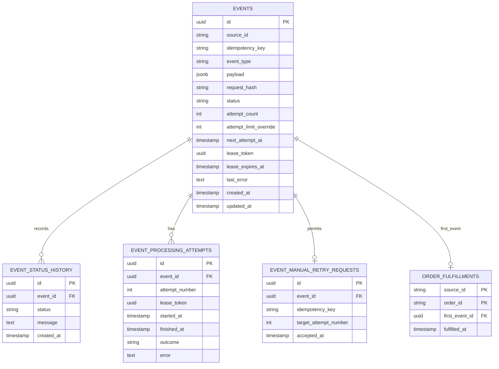

# EventLedger architecture

This document describes the EventLedger application and local delivery model. PostgreSQL is both the durable event store and the worker-coordination mechanism; there is no broker or in-memory queue. For the EC2 blue/green topology, Caddy, CI/CD, AWS services and deployment trade-offs, see [ShipSafe AWS architecture](../shipsafe/docs/AWS_HANDOVER.md#architecture-and-decisions). Local delivery runs `upgrade head`; ShipSafe AWS bootstrap deliberately targets the supported fixed revision.

## Components and dependencies

Application code supplies validation, authentication, retry policy, handler classification, and fencing checks. PostgreSQL supplies durable commits, row locks, uniqueness, foreign keys, and check constraints. Compose supplies service wiring, database health gating, a one-shot migration service, process restart policies, and API port binding; it does not change application-level delivery semantics.

## Ingestion and duplicate detection

The unique constraint is `(source_id, idempotency_key)`. The request cannot provide `source_id`; it comes from the authenticated server-side mapping.

## Claiming, execution, retry, and finalization

Eligible rows satisfy `status = pending`, `next_attempt_at <= clock_timestamp()`, and `attempt_count < effective limit`. Ordering is `next_attempt_at`, then `created_at`, then `id`; this is deterministic selection among currently eligible rows, not a global FIFO guarantee.

`FOR UPDATE SKIP LOCKED` lets concurrent workers skip a row another transaction has claimed. The claim transaction atomically changes the event to `processing`, increments `attempt_count`, creates an unfinished attempt row, assigns a UUID lease token and expiry, and appends status history.

Handler execution occurs after the claim transaction commits. Success and failure are finalized in separate transactions. Finalization locks the event and attempt, matches the claim's lease token and attempt number, and checks that the lease has not expired.

## Lease expiry and crash recovery

If the expired event lacks its matching unfinished attempt, recovery quarantines it as `failed` with an internal consistency error. There is no lease heartbeat; a valid long-running handler can lose ownership if it exceeds the configured lease duration.

## Manual retry authorization and replay

Eligibility requires a source-owned `failed` event, no active lease, no prior override or retry request, contiguous attempt history matching `attempt_count`, and a latest completed outcome of `retryable_failure` or `lease_expired`. `permanent_failure` is not eligible. The event lock serializes concurrent authorization requests. A unique constraint on `event_manual_retry_requests.event_id` independently enforces one grant per event.

## Data model

Important database rules include:

- Events are unique on `(source_id, idempotency_key)`.
- Event status, nonnegative attempt count, lease-state consistency, and per-event override validity are check-constrained.
- Attempts are unique on `(event_id, attempt_number)` and on `lease_token`; active/completed fields and outcomes are constrained.
- Manual retry requests are unique on `event_id`, with a positive target attempt.
- Fulfillments have primary key `(source_id, order_id)` and unique `first_event_id`.
- Foreign keys connect history, attempts, retry requests, and fulfillment to their event.

`event_status_history.message`, `event_processing_attempts.error`, `events.last_error`, and lease tokens are internal. Public history omits messages, and public attempts derive `error_summary` solely from a fixed outcome mapping.

## Transaction boundaries

- Ingestion: event plus initial history commit together. Duplicate reads roll back before returning.
- Claim: row selection, attempt increment, lease assignment, attempt creation, and processing history commit together.
- Recovery: expired-attempt finalization and event rescheduling or failure commit together.
- Success: fulfillment insert/check, attempt completion, lease cleanup, event completion, and history commit together.
- Failure: attempt outcome, sanitized internal error, retry schedule or terminal state, lease cleanup, and history commit together.
- Manual authorization: event lock, eligibility checks, retry audit row, exact override, pending transition, and history commit together.

The handler itself runs outside a database transaction that spans execution. This avoids holding the claim lock for the full handler duration but means handler code may run more than once around crashes and lease expiry.
