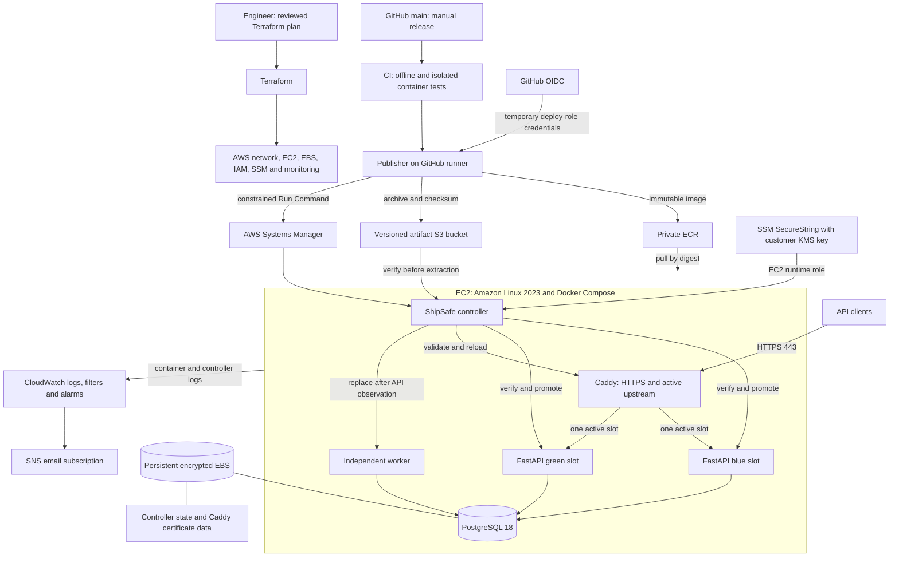

# ShipSafe AWS handover

ShipSafe deploys EventLedger on a single AWS host while keeping release identity,
traffic routing and worker replacement under one controller. It addresses failed
application replacements, mismatched API/worker releases, mutable image references
and unverified remote commands. It does not provide host or database failover.

The AWS demonstration used account `542468167362`, Region `us-east-1`, and
`https://shipsafe.mhasnain.me`. This is a recorded demonstration endpoint, not a
promise that the temporary environment remains online. See [live evidence](AWS_RESULTS.md)
for the successful release, injected failure, automatic recovery and same-SHA retry.

## Architecture and decisions



Both API slots share the same database. This keeps the demo small and makes
schema compatibility a hard requirement: reverting an image cannot undo a
destructive migration. Deploy and rollback do not run migrations; bootstrap
targets the known revision `d4e5f6a7b8c9`. The compatibility-table bridge exists
in code, but a new contract-table migration is not part of this deployment.

Caddy publishes TCP 80/443; the security group does not expose SSH, PostgreSQL,
API slots or Docker. Controller HTTP checks use host-loopback port 8080, while
Caddy admin port 2019 stays container-local. Backend services use an internal
Compose network; Caddy also joins the edge network. The data bind mount is
`/data/shipsafe/postgres` to `/var/lib/postgresql`, not a Docker named volume in
production. EBS also retains controller records and Caddy data/config. Source
directories under `/opt/shipsafe/releases/<sha>` and Docker image storage remain
on the host; preserving the data volume alone is not complete host recovery.

## Infrastructure and first deployment

The [bootstrap module](../infra/bootstrap/main.tf) creates the protected S3 state
bucket and uses local state. The [main module](../infra/main/main.tf) uses an S3
backend with native lockfiles configured by the operator. Preserve both state
histories. Main Terraform manages the VPC/subnet/routes/security group, EC2,
encrypted gp3 EBS attachment, ECR, artifact S3, IAM/OIDC, KMS, constrained SSM
documents, CloudWatch, SNS and Budget. It does not create ECS, EKS, ALB, RDS,
NAT Gateway or DNS records. DNS is an operator-managed prerequisite.

Prerequisites for reproducing the AWS exercise:

1. Python 3.12, Git, Docker Engine/Compose v2, AWS CLI and Terraform (CI pins
   1.14.3). Use authorized temporary operator credentials for infrastructure;
   do not give Terraform administration to the GitHub deploy role.
2. Configure ignored tfvars/backend settings from reviewed examples, confirming
   account, Region, AMI, availability zone, instance/volume sizing, controlled
   domain and alert recipient. Review a fresh authenticated locked plan before
   separately approving an apply. Saved plans and state may be sensitive; do not
   publish them. Old saved plans in the working directory are not deployment instructions.
3. Verify cloud-init, `/usr/bin/python3.12`, SSM Agent >= 3.3.2746.0, Docker, the
   exact EBS mount/canary and `/var/lib/shipsafe-bootstrap.ready`. Never format an
   existing volume to repair bootstrap. User data changes are ignored on the
   existing EC2 resource; a source fix does not retroactively rerun cloud-init.
4. Provision the five runtime SecureStrings using the interactive
   `python -m shipsafe.provision_secrets --key-arn <actual-output>` tool from an
   authorized operator session (`.[operators]` is required). See the retained
   [secret provisioning procedure](PHASE3C_RUNBOOK.md#secure-runtime-configuration-after-the-kms-key-exists).
5. Point the controlled domain A record to `ec2_public_ip`; do not add AAAA
   without working IPv6. The auto-assigned IPv4 can change after stop/start.
6. Set non-secret repository variables `SHIPSAFE_DEPLOY_ROLE_ARN`,
   `SHIPSAFE_INSTANCE_ID`, `SHIPSAFE_DOMAIN`, `SHIPSAFE_PUBLIC_IP` from outputs.
   Confirm SNS email subscription separately; configured email does not prove delivery.
7. Run CI, then manually dispatch `ShipSafe release` on `main` with
   `operation=bootstrap`, `failure_mode=none` for the first release only.
   Subsequent releases use `deploy`. Inspect SSM/controller state and public HTTPS.

Bootstrap starts DB, checks health, applies the fixed migration, verifies both
API slots, starts Caddy and independently verifies the worker. A failed first
bootstrap stops application services, keeps the database and records failure;
inspect/fix the dependency before explicitly retrying. It refuses to reset an
already healthy bootstrapped installation.

## Authentication and trust boundaries

The [release workflow](../../.github/workflows/shipsafe-release.yml) is manual,
restricted to this repository's `main`, and grants `id-token: write` only to the
publish job. IAM verifies audience `sts.amazonaws.com` and, with the current
immutable-subject settings, subject
`repo:MHS-4ever@112760992/EventLedger@1438492915:ref:refs/heads/main`.
The optional classic-subject fallback defaults to false. Adding a GitHub
Environment would change the subject and needs a separate trust review.

**Known action warning:** the pinned AWS credentials action reports
`allowed-account-ids` as unsupported. The workflow still supplies it, but it
must not be credited as an account guard. Independently, `publisher.py` calls
STS `get-caller-identity` and rejects any account other than `542468167362`
before ECR publication or SSM dispatch. Repository/ref checks and IAM trust are
separate controls. The publisher checks runner environment values; those checks
alone are not a substitute for IAM enforcement. Correcting the action/input
compatibility is future implementation work, outside this documentation change.

The deploy role can publish/pull in the approved ECR repository, write/read the
approved artifact prefix and invoke the three custom SSM documents against
instances tagged `Project=ShipSafe`; the publisher selects an explicit instance
ID. IAM's instance scope is tag-based, not restricted to one immutable instance
ID. It does not grant arbitrary `AWS-RunShellScript`, runtime secret reads or
Terraform administration. Main workflow/code modification remains privileged:
the workflow publishes executable controller source from that trusted commit.

The EC2 role pulls images/artifacts and writes logs. Its runtime parameter read
scope is `/shipsafe/runtime/`, with an explicit deny outside that namespace;
KMS decryption is constrained to the parameter-store key via the SSM service. Authorized
account administrators remain privileged. Five SecureStrings hold DB name,
user/password, API key and source ID. The host helper atomically writes
root-owned mode-0600 `/data/shipsafe/runtime.env` after validation. Values are
not Terraform inputs or SSM deployment command parameters. Root/Docker access
can still inspect container environments. Avoid shell tracing, decrypted
parameter output, verbose Compose config and environment dumps. Stored password
rotation alone does not change an initialized PostgreSQL role password.

## Build, artifact and release identity

CI runs Python/offline tests, Terraform validation, production Compose/Caddy
checks, isolated PostgreSQL integration and local container acceptance before
bootstrap/deploy can publish. Status and manual rollback skip build CI and do
not publish new artifacts. Workflow concurrency does not cancel an earlier
production run; host publisher/controller locks also serialize operations.

The publisher builds linux/amd64, labels the image with the full commit SHA and
publishes immutable ECR tag `sha-<sha>`. A rerun reuses the existing digest only
after verifying its revision label. Deployment uses the ECR digest, not a
floating tag. A deterministic tar/gzip archive packages committed allowlisted
source plus `deployment.json`; `.env`, Terraform, tests and runtime state are
excluded. Conditional S3 writes refuse overwrite, and an existing archive must
match byte-for-byte. The SSM document validates approved image/bucket patterns,
SHA/checksum, safe member paths, exact file set, individual hashes and manifest
identity before extracting and installing the SHA-named directory.

Controller release IDs combine 12 source-SHA characters and 12 Docker image-ID
characters. Docker image IDs differ from ECR manifest digests. Local release
tags are re-inspected against recorded image IDs. See [manifest/state fields](RELEASE_MANIFEST.md).
These hashes establish identity/integrity, not signed provenance. Retaining a
digest enables reuse; unlocked Python dependencies mean a new future build is
not guaranteed bit-identical. ECR lifecycle retention can expire older releases;
retain required rollback images, local source and manifests deliberately.

## Promotion, verification and rollback

For a normal deploy the controller:

1. Resolves/registers the release and rejects an interrupted pending operation.
2. Starts only the inactive API with `--no-deps`, keeping the previous API/worker.
3. Checks candidate `/ready` and authenticated read-only `/v1/auth/check`.
4. Validates/reloads Caddy to the candidate and observes proxy readiness/auth.
5. Stops the old worker with its grace period, starts the candidate worker,
   checks it remains running and creates a marked synthetic `order.created`
   event through the proxy. It waits for that event to reach `completed`.
6. Records API/worker verification, active/previous releases and clears pending
   state only after success. The publisher then checks certificate-trusted public
   HTTPS `/health`, `/ready`, and HTTP-to-HTTPS redirection.

`/health` proves process liveness only. `/ready` queries the DB and validates the
supported schema. Neither proves worker progress; the synthetic event provides
that separate check and leaves durable test data. Use a dedicated source. Worker
replacement includes a processing pause; temporary API/worker version overlap
requires compatibility. EventLedger handlers may execute more than once around
lease expiry/crashes; rollback does not change those application semantics.

| Operation | Trigger and behavior |
|---|---|
| Automatic rollback | A caught deployment error restores the old proxy before reporting failure. Candidate verification failure never promotes. Post-promotion observation failure restores the old API and leaves the original worker untouched. Worker verification failure restores both worker and proxy. Recovery itself can fail if old services/host are unhealthy. |
| Manual rollback | Operator dispatches `rollback` with `failure_mode=none` and optional `release_id`; otherwise uses recorded previous release. Target must have API and worker verification, matching schema contract and retained image. It passes through the normal candidate/promotion/worker checks. No database downgrade. |
| Interrupted-operation recovery | `recover` repairs recorded partial phases; it is an operator controller command, not one of the GitHub release inputs. It requires a separately authorized host/SSM operator session and inspection before execution. |

The gated demonstration accepts only `none` and `post-promotion`, and injection
only with `deploy`. Workflow, publisher, SSM schema and shell gate validate it.
The shell clears inherited opt-in and supplies `SHIPSAFE_ENABLE_FAILURE_INJECTION=1`
only to the authorized controller process. It stops the candidate after traffic
switches, so a brief API interruption is expected. The failed SSM/workflow result
does not mean rollback failed. Use [the demonstration procedure](../../docs/SHIPSAFE_ROLLBACK_DEMO.md)
and [recorded AWS results](AWS_RESULTS.md). An already active SHA is a no-op.

## Monitoring and troubleshooting

CloudWatch groups are `/shipsafe/production` plus `/api`, `/worker`, `/controller`
and `/caddy`. Production Compose uses Docker `awslogs`; SSM output uses the
controller group. Retention is configurable (default 30 days). Caddy strips
request headers/URI and response headers from access logs; other operational
records still require access control. Log permission failures can prevent
container creation. Do not assume application logs are secret-free in every
future code path.

Configured alarms cover average EC2 CPU >90% over 300 seconds, failed EC2 status
checks over two 60-second periods, and at least one `DeploymentErrors` metric
over 300 seconds. Controller log filters derive deployment events and errors;
the failure filter matches `ShipSafe error`. SNS email needs confirmed
subscription. These are implemented settings, not evidence that every alert
was received during the demo. No continuous external uptime probe, disk/queue
dashboard, tracing or tested alert-response SLO is claimed. Budget notifications
are delayed cost signals, not a spending cap or shutdown mechanism.

| Symptom | Inspect and recover safely |
|---|---|
| Failed workflow | Identify exact SSM command/status and controller phase first. A canceled workflow can leave SSM running. Do not dispatch overlapping retries. |
| SSM success but public HTTPS failure | Release may already be active. Check DNS A record/current public IP, TCP 80/443, certificate issuance and Caddy logs. Do not blindly bootstrap. |
| Injected failure | Confirm old active slot/release, unchanged worker, no pending deployment and public readiness. Dispatch a fresh run with `none` on the same new SHA; rerun retains injection inputs. |
| Readiness failure | Inspect DB availability and exact supported revision/contract. Never bypass readiness or downgrade/reset production data as a repair shortcut. |
| Worker verification failure | Check worker logs, compatibility and marked event status. Controller attempts worker/proxy restoration; verify its outcome independently. |
| Missing mount/canary or old SSM Agent | Stop release work. Verify provisioned volume ID/attachment and Agent version. Do not create an empty replacement DB directory or format storage. |
| Pending deployment | Preserve state/manifests and logs; verify no controller is running. Use separately authorized `recover`, not state deletion or lock bypass. |
| Image/artifact mismatch | Stop and investigate source/digest/checksum identity. Do not overwrite immutable objects or retag a recorded release to force acceptance. |

For operator recovery, select the inspected current release root (or inspect the
pending root if no current root exists), retain production paths/project name
and use `/usr/bin/python3.12`. The [interpreter recovery guide](PYTHON312_RECOVERY.md)
contains the established host procedure. Run status and inspect records before
any mutation; never copy local-runbook defaults onto the production host.

## Failures resolved during deployment

**Python bootstrap:** AL2023 system `/usr/bin/python3` was Python 3.9, while the
controller uses newer features including `dataclass(slots=True)`. The fix installs
Python 3.12 alongside system Python, invokes `/usr/bin/python3.12` explicitly and
fails in the common SSM guard if absent. It does not replace OS symlinks or EC2.
See [PR #3](https://github.com/MHS-4ever/EventLedger/pull/3) and the
[recovery guide](PYTHON312_RECOVERY.md). Lesson: container Python and host
automation Python are separate dependencies, both requiring explicit validation.

**PostgreSQL permissions:** the persistent parent was root-owned mode 0700,
preventing the pinned PostgreSQL 18 container user from using its `18/docker`
layout. The fix validates the exact EBS mount/canary, rejects symlink/non-directory
parents and uses nonrecursive `install -d -o 999 -g 999 -m 0700` on the parent
only. It does not traverse, delete, reinitialize or recursively chown cluster
contents. Existing-host repair requires separately reviewed operator work;
ignored user data does not rerun automatically. See
[PR #4](https://github.com/MHS-4ever/EventLedger/pull/4) and the metadata-preservation
test in [readiness tests](../../tests/test_shipsafe_readiness.py). Lesson: verify
numeric container ownership and actual major-version data layout on bind mounts.

## Local reproduction and validation

Examples below are for an isolated local checkout, not production operations.
Use Python 3.12, Docker/Compose, Terraform with cached/offline-test providers and
Bash (Git Bash on Windows for rendered-script tests). Do not connect test DBs to AWS.

```powershell
python -m pip install -e '.[dev]'
terraform -chdir=shipsafe/infra/main init -backend=false -input=false
terraform -chdir=shipsafe/infra/main validate
terraform fmt -check shipsafe/infra/main
terraform -chdir=shipsafe/infra/main test
python -m pytest -q -m 'not pg_integration'
```

Use a separate checkout for backend-disabled local checks if the operator's main
workspace is already initialized against remote state. Terraform tests use mocked
providers and plan-only runs. For isolated DB setup, opt-in integration commands
and local API use, see the [README](../../README.md#tests). For container bootstrap,
deployment, manual rollback, interrupted recovery and broader local-only failure
modes, see [local runbook](LOCAL_RUNBOOK.md). CI's exact acceptance commands are
in [shipsafe-ci.yml](../../.github/workflows/shipsafe-ci.yml). Local success is
distinct from the [live AWS evidence](AWS_RESULTS.md).

The publisher defaults to a no-network dry run, for example:

```powershell
python -m shipsafe.publisher --operation deploy --failure-mode none
```

Do not add `--execute` locally: execution is restricted to the repository's main
workflow. Production status/rollback are manual workflow operations, not local
Compose commands.

## Limitations and future work

- One host/proxy/database/volume is a failure domain. Blue/green does not supply
  multi-AZ availability, autoscaling or an uptime guarantee. Injected API failure
  can interrupt requests and worker replacement pauses processing.
- Backup automation, tested disaster restore, replication and point-in-time
  recovery are not established. Persistent EBS and `prevent_destroy` are not backups.
- One static API key/source, no rotation workflow, edge rate limiting/WAF or
  separate application operator role. Root/Docker and trusted-main access are privileged.
- No signed artifacts/SBOM enforcement or vulnerability-scan deployment gate is
  established; ECR scan-on-push alone is not such a gate. Dependencies are not
  lockfile-resolved. Retention must preserve intended rollback targets.
- Deployment history survives on the data EBS but complete host reconstruction
  requires source/images/config as well. Runtime secrets and KMS access must be retained.
- Supported schema is deliberately fixed; expand/contract migrations need future
  design/testing. Rollback does not undo data changes or external side effects.
- The credentials-action input warning remains unresolved. Future work should
  review its pinned interface, preserve STS account validation, add backup/restore
  drills and external readiness/queue/disk alerts, then evaluate availability
  improvements against measured needs. No load, latency or availability benchmark
  is claimed.

Use the [teardown and redeployment checklist](AWS_TEARDOWN.md) before closing the
temporary AWS exercise. Phase reports remain historical; this guide and
[AWS results](AWS_RESULTS.md) describe the final demonstrated system.
